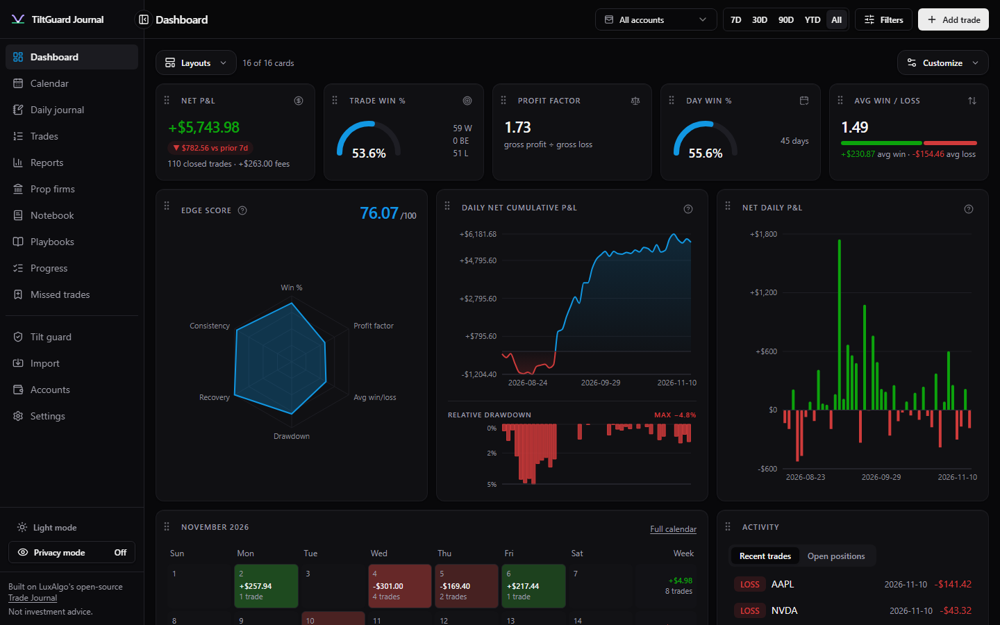

# TiltGuard Journal

A self-hosted trading journal for futures day traders: broker and platform imports, P&L calendar, analytics,
prop-firm tracking, daily journal and AI recaps. Your data stays in a local SQLite database.

This is a fork of [LuxAlgo's open-source Trade Journal](https://github.com/LuxAlgo/trade-journal) (MIT).
It is not affiliated with or endorsed by LuxAlgo Global, LLC. The upstream documentation is in
[docs/UPSTREAM_README.md](docs/UPSTREAM_README.md).

> **Disclaimer:** Not financial advice. This project is for educational purposes only, provided as is,
> with no warranty. You are responsible for your own trading decisions.


<!-- TODO: add a screenshot at docs/screenshot.png (use demo data, not your real account) -->

## What this fork adds

- **TiltGuard integration**: sidebar link to a [TiltGuard](https://github.com/Aminou973/tiltguard) lockout server served at `/guard/`,
  and a "TiltGuard bars (NQ / ES)" market-data provider that reads 1-minute candles from a local TiltGuard backend.
- **Read-only demo build** (`JOURNAL_DEMO=1`, optional `JOURNAL_BASE_PATH=/journal-demo`) for hosting a public demo under a sub-path.
- Own branding ("TiltGuard Journal" name, logo, icons) in place of the LuxAlgo marks.

## Install and run

Requires Node.js 22+ and pnpm 9+.

```bash
pnpm install
pnpm dev          # http://localhost:3000
```

Production: `pnpm build && pnpm start`, or `docker compose up -d` (see `Dockerfile` / `docker-compose.yml`).

Tests: `pnpm test` and `pnpm typecheck`.

## Configuration

Copy `.env.example` to `.env` (gitignored). Everything is optional:

| Variable                               | Purpose                                                                   |
| -------------------------------------- | ------------------------------------------------------------------------- |
| `JOURNAL_PASSWORD`                     | Require a password (recommended beyond localhost)                         |
| `JOURNAL_SECRET`                       | Key source for encrypting broker/AI credentials at rest                   |
| `JOURNAL_DATA_DIR`                     | Where the SQLite database lives (default `./data`)                        |
| `ANTHROPIC_API_KEY` / `OPENAI_API_KEY` | AI features (can also be set in Settings)                                 |
| `TILTGUARD_BARS_URL`                   | TiltGuard backend for the bars provider (default `http://127.0.0.1:8940`) |
| `JOURNAL_DEMO`, `JOURNAL_BASE_PATH`    | Build-time switches for the read-only demo                                |

Never commit `data/` or `.env`: they hold your trades and keys.

## License

[MIT](LICENSE). Original code © LuxAlgo Global, LLC; fork changes © their authors.
"LuxAlgo" and "Trade Journal" are trademarks of LuxAlgo Global, LLC; see [TRADEMARKS.md](TRADEMARKS.md).
